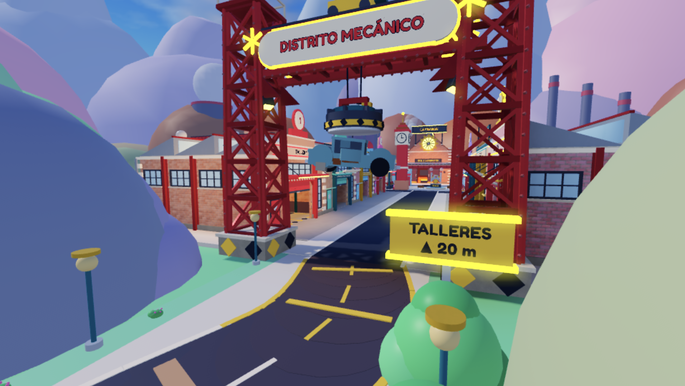
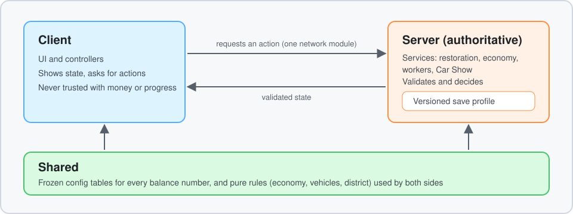
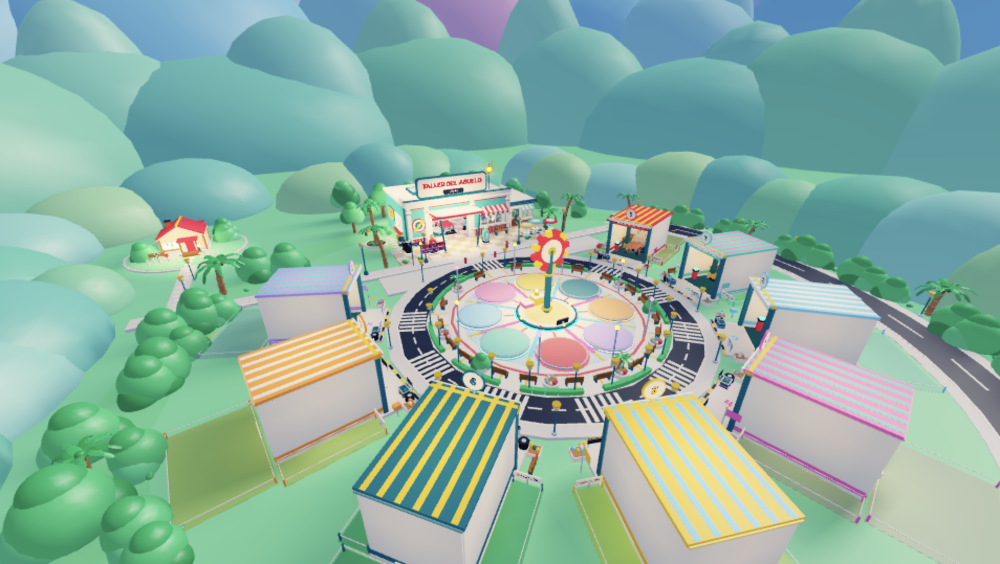
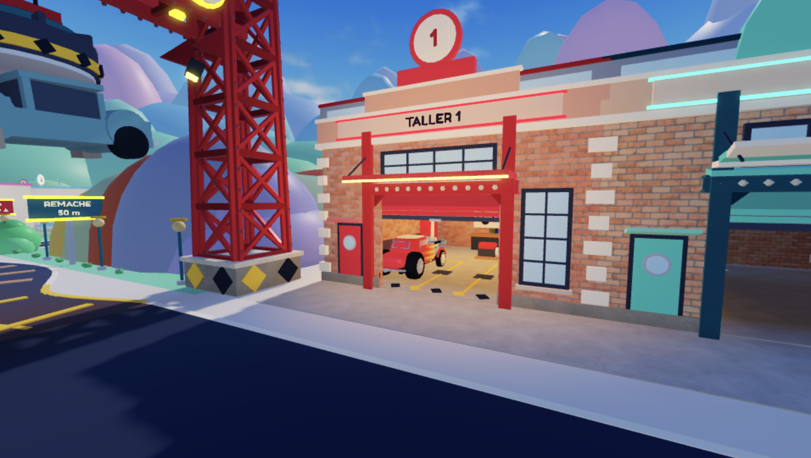
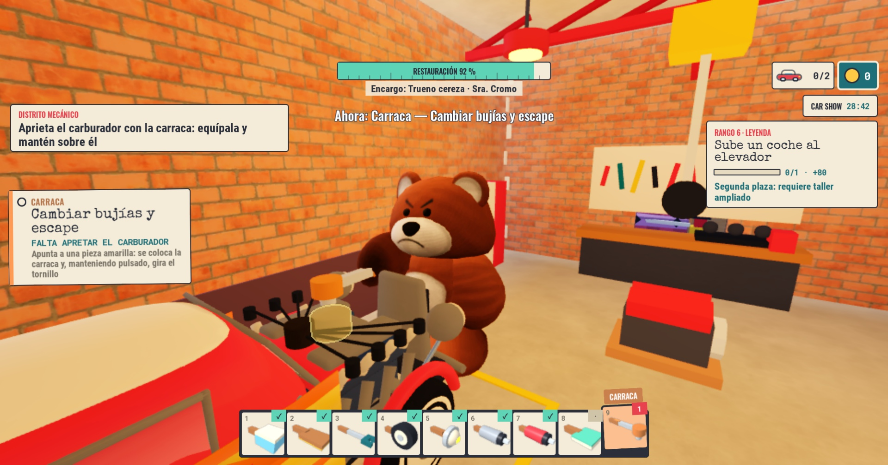
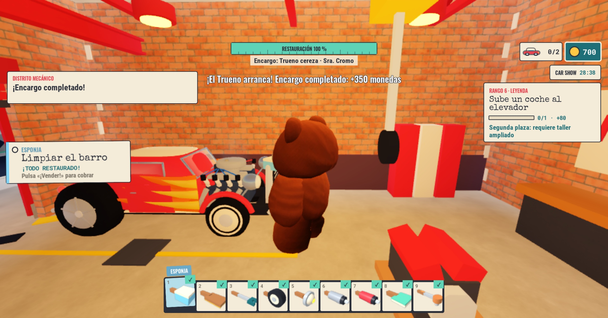

<h1 align="center">Junk to Luxury Simulator</h1>

<strong>Find a wreck. Restore it. Turn a tiny garage into a business.</strong>

A Roblox simulation with its own art direction, <em>Candy Chrome</em> &nbsp;·&nbsp; In development &nbsp;·&nbsp; Source code private

<!-- captures:hero:start -->

  

The entrance arch of the Mechanic District. Provisional Roblox Studio capture, Play mode.

<!-- captures:hero:end -->

&nbsp;

## At a glance

| Fact | Detail |
|---|---|
| **Genre** | Restoration and business simulation |
| **Platform** | Roblox (private experience, not released) |
| **Built with** | Luau in strict mode, Rojo, Blender, Git |
| **Status** | **In development.** Playable in Roblox Studio. Not yet tested on real devices or with real players |
| **Started** | 2026-10-28 (first commit) |
| **Size** | About 46,900 lines of Luau in 235 files, with 56 modules in its test folder, a few of them helper tools (counted 2026-11-16) |
| **Code** | Private. This repository presents the project: design, architecture, engineering notes and screenshots |

&nbsp;

## The game

The player starts with a small workshop and a pile of scrap. Cars arrive rusty and broken, and the player restores them by hand with physical tools. Then comes a choice: sell the car, or keep it in a personal collection that pays a bonus and can be shown in a Car Show held on each server. Money buys better tools, a bigger workshop, a second bay with a lift and employees (Tito and Lola).

More zones are planned. The first, the **Mechanic District**, already has a first playable loop: a hot rod arrives with a faulty carburettor, and the player finds the part, tunes it on the bench, fits it with the ratchet and starts the engine. The loop needs a district licence, earned at 50 sales.

**Visual direction.** *Candy Chrome*: saturated colour, thick rounded shapes and readable silhouettes, inspired by 1950s and 60s car culture. The interface uses paper, ink and stamps. The three cars (Brisa 68, Trueno 55, Cometa 62) are generated by Python scripts in Blender and imported into Studio. The town and the district are assembled in-game by Luau builder scripts from simple parts.

&nbsp;

## Status ledger

| System | Implemented | Automated tests (run in Studio by Claude Code) | Play-through in Studio (run by Claude Code) | Pending |
|---|:-:|:-:|:-:|---|
| Staged restoration, tools and machines (3 cars) | ✓ | ✓ | | Balance with real players |
| Expandable workshop, two lifts, employees (Tito, Lola) | ✓ | ✓ | | |
| Jobs, ranks, economy, shop | ✓ | ✓ | | A 30-minute from-scratch playtest |
| Saving progress and half-restored cars | ✓ | ✓ (in-memory store only) | | **Real DataStore** (pending; no conclusive evidence yet) |
| My Collection and Car Show | ✓ | ✓ (with bots) | | Several real clients |
| Mechanic District, first loop (carburettor) | ✓ | ✓ | ✓ keyboard | Mouse, phone, two players |
| Mobile interface and performance | | | | **Not measured on a device** |
| Audio | | | | Original audio. Only third-party placeholder effects exist |

*Automated tests* are test modules run inside Roblox Studio, and the *play-through* is a keyboard run of the first district loop; in both cases Claude Code ran them through its Studio bridge. **This table does not credit any feature to the owner's own hand testing**: that would be listed only once confirmed. The entries reproduce the project's own notes (2026-11-02 for the first rows, 2026-11-15 for the district) and have **not** been re-run for this page.

&nbsp;

## Architecture

  

- **Server-authoritative by design.** The client asks and the server validates and decides. Balance numbers live in frozen config tables, not in logic.
- **Small strict modules.** One responsibility each, in Luau strict mode. Entry scripts only start services.
- **Rojo manages code only.** Maps, models and UI are authored in Studio and are never overwritten by synchronisation.

&nbsp;

## Engineering notes

**One restoration engine, every car.** The logic is written once and each car only supplies data, through a vehicle registry used by the server, the client, the employees, saving and the tests. Adding a car means a Blender manifest plus data rows, and one test restores every variant of every model and compares it with its template.

**Saving a half-restored garage.** The profile is a versioned record with a session lock, a load generation and sanitising on load. A saved car is a record of about 320 bytes, with no parts or geometry, and is rebuilt from the approved template with the same services used in play. Writes are grouped to respect Roblox's limit of one write per key every six seconds, with an autosave every 120 seconds and on shutdown. Tested with an in-memory store; **real-DataStore validation of the full save is pending.**

**Measure before you build.** Before building the Mechanic District, a measurement pass in Studio compared Villa Tuercas alone with a placeholder district. The placeholder's 3,158 pieces added about 4.8% to the client's instances, but each cloned car costs about 18,500 drawn triangles, so 16 cars take a view from 248k to 545k triangles. The recommendation was to keep a single Place, conditional on a test on a real phone, which is still pending. These are Studio measurements, not device measurements.

**Draw calls, not triangles.** On the avenue view, the eight workshops cost 52 draw calls but only about 24k triangles. Merging unions per material cut them to 32 (the whole view fell from 138 to 118), with a 3% change in triangles and an identical screenshot. A further cut was documented and deliberately not made, because nothing showed it was needed.

&nbsp;

## Screenshots

<!-- captures:gallery:start -->

| | |
|---|---|
|  |  |
| *Villa Tuercas, the hub town: a plaza ringed by eight workshops.* | *Workshop 1 on the Mechanic District avenue.* |
|  |  |
| *Fitting a part with the ratchet: equip it, then hold.* | *End of the first district loop: the engine starts and the job pays 350 coins.* |

**All five images are provisional.** They are Roblox Studio captures of work in progress, taken in Play mode, and final captures will replace them. The in-game text is in Spanish.

<!-- captures:gallery:end -->

&nbsp;

## How it is built

- **Code:** Luau in Roblox Studio, synchronised with Rojo 7.7.1 (installed with Rokit) and versioned with Git.
- **Art:** Blender for the cars; Luau builder scripts for the town, the district and the interface.
- **AI assistance:** the Luau implementation, the Blender scripts, the test modules and the documentation are written with Claude Code. It also runs the automated tests and play-throughs inside Studio through a Studio bridge (MCP) and reviews code.
- **My role:** I make the product decisions, define the mechanics and the visual direction, supervise the AI-assisted work and evaluate the results. Where a result comes from my own hand testing, this page says so; today it credits none to it.
- **Method:** every system is reported as Implemented, Tested (with evidence and who ran it) or Pending.

**Third-party content.** The game uses free sound effects from the Roblox Creator Store (publishers such as Pro Sound Effects, plus community uploads) as placeholders. They are not original work, are not part of this repository, and belong to their authors. The interface uses Roblox's built-in fonts. This page makes no claim about the provenance of the 3D models, textures or other assets beyond what is stated above.

&nbsp;

## Roadmap

Planned work, not promised:

1. Private-beta validation: real DataStore, phone and emulator, several clients, a 30-minute first session.
2. The Mechanic District beyond its first loop: larger workshops, professional machinery and workers.
3. New vehicles, which need new 3D models.
4. Original audio.

&nbsp;

## Why the code is private

The source code, 3D models and place files of the game are private. This repository contains only this README and the screenshots above.

&nbsp;

© 2026 Lucas Ramos. All rights reserved on the documentation and the original project material in this repository: it may not be reused without permission. This does not extend to third-party content, such as the Roblox platform and its built-in fonts or the Creator Store sound effects mentioned above, which belongs to its respective owners. Junk to Luxury Simulator is an independent project, not affiliated with or endorsed by Roblox Corporation. Roblox is a trademark of Roblox Corporation.
